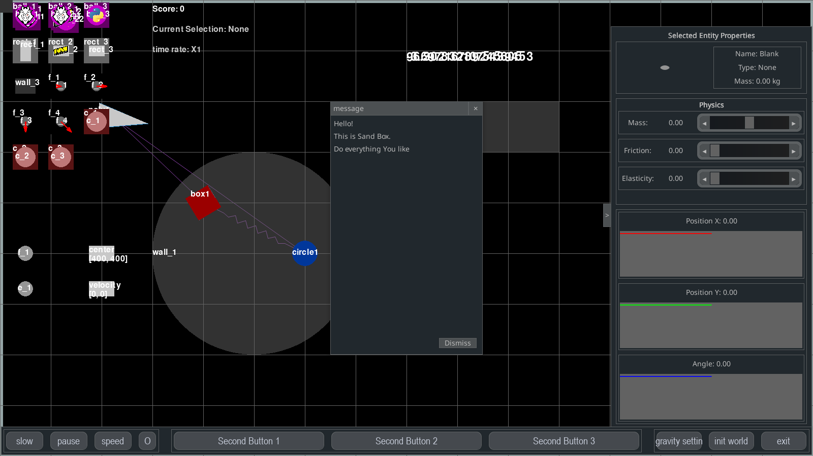
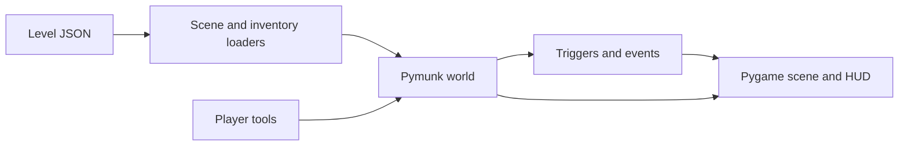

# Physics Puzzle / PhyGame

**A data-driven 2D physics puzzle prototype.** Build and inspect scenes with bodies, forces and constraints using Pygame for interaction and Pymunk for simulation.

[简体中文](README.zh-CN.md) · [Help](Help.md) · [Level/event configuration](core/2024-8-26.event_system_json_config_help.md) · [History](docs/README-history.md)



*Headless actual-renderer frame from public revision `dec24a1`: unchanged sandbox, 60 frames, complete 1600 × 900 surface. It is not a native desktop screenshot or human gameplay acceptance. [Capture and reproduction](docs/showcase/README.md).*



*Implementation diagram. No generated artwork is presented as a gameplay screenshot.*

## Run locally

Use Python **3.11** as the original development baseline:

```bash
python -m pip install -r requirements.txt
python main.py
```

The pinned stack includes Pygame 2.6.0, pygame_gui 0.6.12 and Pymunk 6.8.1. A graphical desktop is required. The source targets desktop use; compatibility with every Windows/macOS/Linux environment has not been revalidated here.

## What is implemented

- Bodies: boxes, circles and polygons.
- Constraints: pins, slides and springs.
- Tools and forces for manipulating the simulated scene.
- JSON-driven scene, inventory, settings and event/trigger loading.
- Main/chapter/level menus, in-game panels and a sandbox entry.

| Directory | Role |
|---|---|
| [core/](core/) | Physics objects, loaders and event system |
| `gui/`, `menus/` | Editors/panels, menus and gameplay scenes |
| [levels/](levels/) | Level data, sandbox and mechanics chapter material |
| [assets/](assets/) | Existing images, music and UI themes |
| [tests/](tests/) | Source test suite |

Each configured level uses `setting.json`, `scene.json`, `inventory.json` and `events.json`. Some chapter folders contain design material rather than finished playable levels; see their actual files and [level notes](levels/Dev-2024-8-23.general_level_design.md).

## Status and checks

A prototype with implemented mechanics and unfinished level/design work. The original design describes broader educational goals; it is not a claim of a completed curriculum or a validated learning outcome. Pymunk rigid-body behavior is a game model, not a general multiphysics solver.

```bash
python -m pytest tests/
```

This documentation pass rendered the original public sandbox headlessly for 60 frames. Native desktop behavior and human gameplay acceptance were not retested. Read [Help](Help.md) and in-game help for controls.

## License

No repository-wide open-source license is declared in this snapshot. Public source visibility does not grant an unrestricted reuse license; third-party material retains its own terms.
