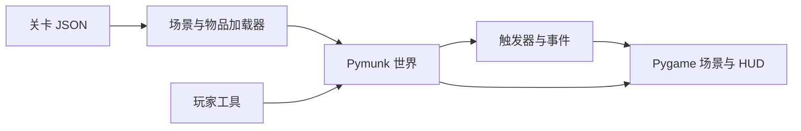

# Physics Puzzle / PhyGame 物理解谜

**由数据驱动的二维物理解谜原型。** 使用刚体、外力与约束构建和检查场景，Pygame 负责交互，Pymunk 负责模拟。

[English](README.md) · [帮助](Help.md) · [关卡／事件配置](core/2024-8-26.event_system_json_config_help.md) · [历史](docs/README-history.md)


*公开版本 `dec24a1` 的原渲染器无头画面：原沙盒运行 60 帧后保存完整 1600 × 900 surface，不是原生桌面截图或人工玩法验收。[生成与复现](docs/showcase/README.md)。*



*图示对应已有实现，没有用生成画作充当游戏截图。*

## 本机运行

原开发基线为 Python **3.11**：

```bash
python -m pip install -r requirements.txt
python main.py
```

锁定依赖包括 Pygame 2.6.0、pygame_gui 0.6.12、Pymunk 6.8.1，需要图形桌面。源码面向桌面端，本次没有重新验证所有 Windows／macOS／Linux 环境。

## 已有实现

- 刚体：矩形、圆及多边形。
- 约束：杆、滑动约束与弹簧。
- 用于操纵场景的工具与外力。
- JSON 场景、物品、设置及事件／触发器加载。
- 主菜单、章节／关卡菜单、游戏面板与沙盒入口。

| 目录 | 职责 |
|---|---|
| [core/](core/) | 物理对象、加载器、事件系统 |
| `gui/`、`menus/` | 面板、菜单与游戏场景 |
| [levels/](levels/) | 关卡、沙盒与力学章节材料 |
| [assets/](assets/) | 原有图片、音乐及界面主题 |
| [tests/](tests/) | 源码测试 |

配置关卡采用 `setting.json`、`scene.json`、`inventory.json`、`events.json`。部分章节目录只有设计材料，并非全部可玩；以实际文件和 [关卡说明](levels/Dev-2024-8-23.general_level_design.md) 为准。

## 状态与检查

项目已有核心机制，仍处于原型与关卡设计阶段。旧设计中的教育目标不代表完整课程已完成或学习效果已验证。Pymunk 刚体行为属于游戏模型，不是通用多物理场求解器。

```bash
python -m pytest tests/
```

本次调用公开源码原渲染器无头生成沙盒 60 帧；未重新验收原生桌面行为或人工游戏体验。操作方式见 [Help](Help.md) 和游戏内帮助。

## 许可

本快照未声明仓库整体的开源许可证。源码公开不等于无限制使用授权；第三方内容仍适用各自条款。
